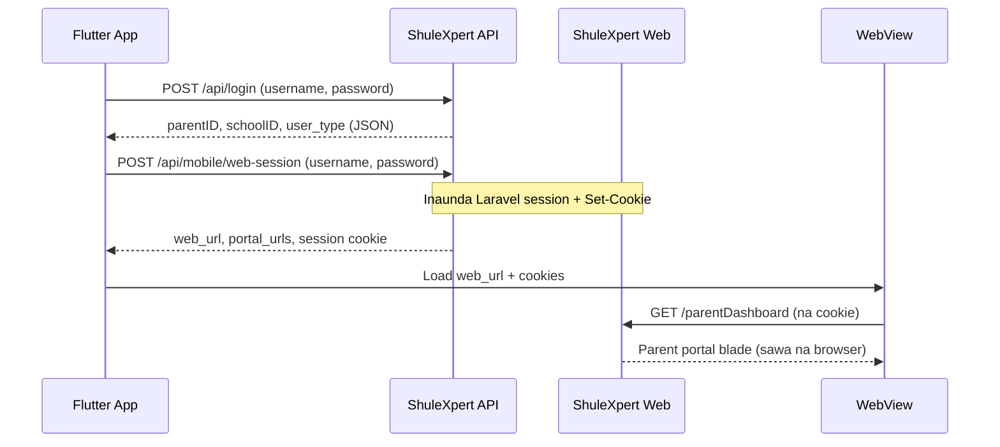

# Flutter Mobile App — Parent Portal WebView Integration

## Muhtasari (Kiswahili)

Hati hii inaelezea jinsi **Flutter Mobile App** inavyoweza kuonyesha **interface ile ile ya mzazi** (parent portal) kama inavyoonekana kwenye browser, baada ya login kupitia API.

### Mfumo wa kufanya kazi

1. Mzazi analogin kwenye App kwa `POST /api/login` (hiari — kwa data za JSON/native screens).
2. App inaita `POST /api/mobile/web-session` kwa username/password **ile ile** — server inaunda **web session** (cookie) kama login ya kawaida ya browser.
3. App inafungua **WebView** na ku-load URL iliyorudishwa (`web_url`) — mzazi anaona dashboard, mahudhurio, matokeo, malipo, nk. **sawa na browser**.

> **Muhimu:** Portal ya mzazi (`/parentDashboard`, `/parentAttendance`, nk.) inategemea **session cookie**, si API headers pekee. Endpoint ya `web-session` ndiyo daraja kati ya App na blades za web.

---

## Base URLs

| Mazingira | Web (Blades) | API |
|-----------|--------------|-----|
| **Server halisi (LAN)** | `http://192.168.1.162:8003` | `http://192.168.1.162:8003/api` |
| **Android Emulator** | `http://10.0.2.2:8003` | `http://10.0.2.2:8003/api` |
| **iOS Simulator** | `http://127.0.0.1:8003` | `http://127.0.0.1:8003/api` |

Weka `BASE_WEB_URL` na `BASE_API_URL` kwenye App config (mf. `.env` ya Flutter).

---

## Mchoro wa Mtiririko



---

## Hatua 1 — Login API (Hiari)

Kwa skrini za native (JSON) tumia login iliyopo:

**Endpoint:** `POST /api/login`

**Headers:**
```
Content-Type: application/json
Accept: application/json
```

**Body:**
```json
{
  "username": "255712345678",
  "password": "nenosiri123"
}
```

**Majibu (Mzazi):**
```json
{
  "success": true,
  "message": "Login successful",
  "data": {
    "user": {
      "id": 10,
      "name": "255712345678",
      "user_type": "parent"
    },
    "parentID": 45,
    "schoolID": 3,
    "parent": {
      "parentID": 45,
      "phone": "255712345678",
      "first_name": "Juma",
      "last_name": "Hassan"
    }
  }
}
```

**Username kwa mzazi:** namba ya simu iliyosajiliwa (`phone`).

Hifadhi `parentID`, `schoolID`, `user_type` kwa API nyingine (malipo, matokeo, nk.).

---

## Hatua 2 — Unda Web Session (Lazima kwa WebView)

**Endpoint:** `POST /api/mobile/web-session`

**Headers:**
```
Content-Type: application/json
Accept: application/json
```

**Body:**
```json
{
  "username": "255712345678",
  "password": "nenosiri123"
}
```

**Majibu ya mafanikio (Mzazi):**
```json
{
  "success": true,
  "redirect": "http://192.168.1.162:8003/parentDashboard",
  "web_url": "http://192.168.1.162:8003/parentDashboard",
  "user_type": "parent",
  "schoolID": 3,
  "parentID": 45,
  "session_active": true,
  "portal_urls": {
    "dashboard": "http://192.168.1.162:8003/parentDashboard",
    "results": "http://192.168.1.162:8003/parentResults",
    "attendance": "http://192.168.1.162:8003/parentAttendance",
    "fingerprint_attendance": "http://192.168.1.162:8003/parentFingerprintAttendance",
    "payments": "http://192.168.1.162:8003/parentPayments",
    "fees_summary": "http://192.168.1.162:8003/parentFeesSummary",
    "subjects": "http://192.168.1.162:8003/parentSubjects",
    "permissions": "http://192.168.1.162:8003/parentPermissions"
  }
}
```

**Majibu ya makosa:**
```json
{
  "success": false,
  "message": "Incorrect username or password!"
}
```

**OTP (Mwalimu/Admin/Staff):** Ikiwa shule ina 2FA, majibu yanaweza kuwa:
```json
{
  "success": true,
  "requires_otp": true,
  "otp_token": "...",
  "masked_phone": "2557***678",
  "expires_in": 600
}
```
Katika hali hii session haijaundwa — mzazi hawezi kupata OTP hapa; tumia login ya wavuti kwa OTP kwanza, au zima OTP kwa shule husika.

---

## Hatua 3 — Fungua WebView

Baada ya `web-session`, load `web_url` kwenye WebView. **Lazima** cookie za session (`laravel_session` / `XSRF-TOKEN`) zisafirishwe kutoka HTTP client hadi WebView.

### Dependencies (`pubspec.yaml`)
```yaml
dependencies:
  flutter:
    sdk: flutter
  webview_flutter: ^4.10.0
  dio: ^5.7.0
  cookie_jar: ^4.0.8
  dio_cookie_manager: ^3.1.1
  path_provider: ^2.1.4
```

### Mfano kamili (Dart)

```dart
import 'dart:io';
import 'package:dio/dio.dart';
import 'package:dio_cookie_manager/dio_cookie_manager.dart';
import 'package:cookie_jar/cookie_jar.dart';
import 'package:path_provider/path_provider.dart';
import 'package:webview_flutter/webview_flutter.dart';

class ShuleXpertConfig {
  static const String baseWeb = 'http://192.168.1.162:8003';
  static const String baseApi = '$baseWeb/api';
}

class ParentPortalService {
  late final Dio _dio;
  late final CookieJar _cookieJar;

  Future<void> init() async {
    final dir = await getApplicationDocumentsDirectory();
    _cookieJar = PersistCookieJar(storage: FileStorage('${dir.path}/cookies'));
    _dio = Dio(BaseOptions(
      baseUrl: ShuleXpertConfig.baseApi,
      headers: {'Accept': 'application/json'},
      connectTimeout: const Duration(seconds: 30),
    ));
    _dio.interceptors.add(CookieManager(_cookieJar));
  }

  /// Login API — data za JSON (hiari)
  Future<Map<String, dynamic>> apiLogin(String username, String password) async {
    final res = await _dio.post('/login', data: {
      'username': username,
      'password': password,
    });
    return Map<String, dynamic>.from(res.data as Map);
  }

  /// Unda web session — lazima kabla ya WebView
  Future<Map<String, dynamic>> createWebSession(
    String username,
    String password,
  ) async {
    final res = await _dio.post('/mobile/web-session', data: {
      'username': username,
      'password': password,
    });
    return Map<String, dynamic>.from(res.data as Map);
  }

  /// Sync cookies kwenda WebView (Android)
  Future<void> syncCookiesToWebView(String url) async {
    if (!Platform.isAndroid) return;
    final cookies = await _cookieJar.loadForRequest(Uri.parse(url));
  }
}

class ParentWebViewScreen extends StatefulWidget {
  final String initialUrl;
  const ParentWebViewScreen({super.key, required this.initialUrl});

  @override
  State<ParentWebViewScreen> createState() => _ParentWebViewScreenState();
}

class _ParentWebViewScreenState extends State<ParentWebViewScreen> {
  late final WebViewController _controller;

  @override
  void initState() {
    super.initState();
    _controller = WebViewController()
      ..setJavaScriptMode(JavaScriptMode.unrestricted)
      ..setNavigationDelegate(NavigationDelegate(
        onNavigationRequest: (req) => NavigationDecision.navigate,
      ))
      ..loadRequest(Uri.parse(widget.initialUrl));
  }

  @override
  Widget build(BuildContext context) {
    return Scaffold(
      appBar: AppBar(title: const Text('ShuleXpert — Mzazi')),
      body: WebViewWidget(controller: _controller),
    );
  }
}

/// Mtiririko wa login → WebView
Future<void> openParentPortal(BuildContext context) async {
  final service = ParentPortalService();
  await service.init();

  const username = '255712345678';
  const password = 'nenosiri123';

  // 1) API login (hiari)
  final loginData = await service.apiLogin(username, password);
  if (loginData['success'] != true) {
    throw Exception(loginData['message'] ?? 'Login imeshindwa');
  }

  // 2) Web session — cookie inaundwa hapa
  final session = await service.createWebSession(username, password);
  if (session['success'] != true) {
    throw Exception(session['message'] ?? 'Web session imeshindwa');
  }

  final webUrl = session['web_url'] as String? ?? session['redirect'] as String;

  // 3) Fungua WebView
  if (context.mounted) {
    Navigator.push(
      context,
      MaterialPageRoute(
        builder: (_) => ParentWebViewScreen(initialUrl: webUrl),
      ),
    );
  }
}
```

### Cookie kwenye Android

Kwa `webview_flutter` 4.x, hakikisha cookies zinashirikiwa:

```dart
import 'package:webview_flutter_android/webview_flutter_android.dart';

if (Platform.isAndroid) {
  final cookieManager = WebViewCookieManager();
  // Baada ya createWebSession, cookies ziko kwenye Dio CookieJar.
  // Tumia WebViewCookieManager.setCookie kwa kila cookie ya domain:
  await cookieManager.setCookie(
    WebViewCookie(
      name: 'laravel_session',
      value: '<thamani kutoka cookie jar>',
      domain: '192.168.1.162',
      path: '/',
    ),
  );
}
```

**Njia rahisi:** Tumia `dio` + `PersistCookieJar`, kisha `WebView` yenye `webview_flutter` inayoshiriki process cookies kwenye Android (kwa kawaida inafanya kazi ikiwa `web-session` na WebView zina domain sawa).

**Njia bora zaidi:** Baada ya `createWebSession`, load `web_url` moja kwa moja — `dio` na `WebView` zinaweza kuhitaji sync ya cookies manually kwenye baadhi ya vifaa. Jaribu kwanza load moja kwa moja; ikiwa inarudisha login, sync cookies kama hapo juu.

---

## Kurasa za Parent Portal (Blades)

| Ukurasa | URL (mfano) | Maelezo |
|---------|-------------|---------|
| Dashboard | `/parentDashboard` | Nyumbani — takwimu, watoto |
| Matokeo | `/parentResults` | Matokeo ya mitihani |
| Mahudhurio (Mfumo) | `/parentAttendance` | Kalenda ya mahudhurio ya mfumo |
| Mahudhurio (Vidole) | `/parentFingerprintAttendance` | Kalenda ya fingerprint |
| Kalenda mtoto | `/parentAttendance/{studentID}` | Kalenda ya mwanafunzi mmoja |
| Kalenda vidole | `/parentFingerprintAttendance/{studentID}` | Fingerprint kwa mtoto mmoja |
| Malipo | `/parentPayments` | Fanya malipo |
| Muhtasari Ada | `/parentFeesSummary` | Muhtasari wa ada |
| Masomo | `/parentSubjects` | Masomo ya watoto |
| Ruhusa | `/parentPermissions` | Omba / simamia ruhusa |

Unaweza kufungua ukurasa wowote kutoka `portal_urls` badala ya dashboard tu.

---

## Aina nyingine za watumiaji (User Types)

`POST /api/mobile/web-session` inafanya kazi kwa **aina zote** zenye login ya web:

| user_type | `web_url` baada ya login |
|-----------|--------------------------|
| `parent` | `/parentDashboard` |
| `Teacher` | `/teachersDashboard` |
| `Admin` | `/AdminDashboard` |
| `Staff` | `/staffDashboard` |
| `SuperAdmin` | `/super-admin/dashboard` |
| `Watchman` | `/watchman/visitors` |

Kwa App ya mzazi tu, angalia `user_type == 'parent'` kabla ya kufungua parent portal.

---

## Logout

### Kutoka App (native)
1. Futa data za `api/login` (parentID, nk.) kwenye storage.
2. Futa cookies: `await cookieJar.deleteAll();`
3. Funga WebView.

### Kutoka WebView (session ya server)
Mzazi anaweza kutoka kupitia UI ya portal, au App inaweza kuita:
```
GET/POST http://192.168.1.162:8003/logout
```
(kwa cookies za session zilizopo)

---

## Usalama

1. **HTTPS** — production lazima `https://`.
2. **Usihifadhi password** — tumia `flutter_secure_storage` kwa session/cookies tu.
3. **Certificate pinning** — inapendekezwa production.
4. **WebView** — zuia URLs nje ya domain yako:
```dart
onNavigationRequest: (req) {
  if (!req.url.startsWith(ShuleXpertConfig.baseWeb)) {
    return NavigationDecision.prevent;
  }
  return NavigationDecision.navigate;
},
```

---

## Utatuzi wa matatizo

| Tatizo | Suluhisho |
|--------|-----------|
| WebView inaonyesha ukurasa wa login | Cookies hazijasafirishwa — rejea sehemu ya Cookie sync |
| `Connection refused` kwenye simu | Tumia IP halisi (`192.168.x.x`), si `localhost` |
| Emulator haiwezi kuunganisha | Android: `10.0.2.2`; iOS: `127.0.0.1` au IP ya Mac |
| `requires_otp: true` | Shule ina 2FA — mzazi hawezi; Admin/Teacher wanahitaji OTP |
| Mahudhurio vidole kimefifia | Darasa halijaruhusiwa na Super Admin — `parent-fingerprint-portal` |
| Picha za watoto hazionekani | Hakikisha `baseWeb` inafikika kutoka simu kwa `userImages/` |

---

## Mfano wa cURL (kupima)

```bash
# 1) API Login
curl -X POST "http://192.168.1.162:8003/api/login" \
  -H "Content-Type: application/json" \
  -H "Accept: application/json" \
  -d '{"username":"255712345678","password":"nenosiri123"}'

# 2) Web Session (hifadhi cookie -c cookies.txt)
curl -c cookies.txt -b cookies.txt -X POST "http://192.168.1.162:8003/api/mobile/web-session" \
  -H "Content-Type: application/json" \
  -H "Accept: application/json" \
  -d '{"username":"255712345678","password":"nenosiri123"}'

# 3) Fungua dashboard kwa cookie
curl -b cookies.txt "http://192.168.1.162:8003/parentDashboard"
```

---

## Muunganisho na API zingine za mzazi

| Kazi | API (JSON) | Web (Blade) |
|------|------------|-------------|
| Dashboard data | `GET /api/parent/dashboard?parentID=&schoolID=` | `/parentDashboard` |
| Matokeo | `GET /api/parent/results` | `/parentResults` |
| Malipo | `GET /api/parent/payments` | `/parentPayments` |
| Ada | `GET /api/parent/fees-summary` | `/parentFeesSummary` |
| Mahudhurio | — (tumia WebView) | `/parentAttendance` |
| Fingerprint | — (tumia WebView) | `/parentFingerprintAttendance` |

**Mapendekezo:** Tumia **API** kwa data ndogo/native widgets; tumia **WebView** kwa kurasa zenye UI kamili (mahudhurio kalenda, ruhusa, nk.).

---

## Faili husika (Backend)

| Faili | Wajibu |
|-------|--------|
| `routes/api.php` | `POST /api/mobile/web-session` |
| `app/Http/Controllers/Auth.php` | `createMobileWebSession()` |
| `app/Http/Controllers/ApiController.php` | `login()` |
| `resources/views/layouts/parent_corp.blade.php` | Layout ya portal ya mzazi |
| `AUTHENTICATION_API_DOCUMENTATION.md` | Login API ya jumla |

---

## Toleo

- **Imeandikwa:** Julai 2026  
- **Server mfano:** `http://192.168.1.162:8003`  
- **Inaendana na:** Parent portal (mfumo + fingerprint), Flutter 3.x, `webview_flutter` 4.x
